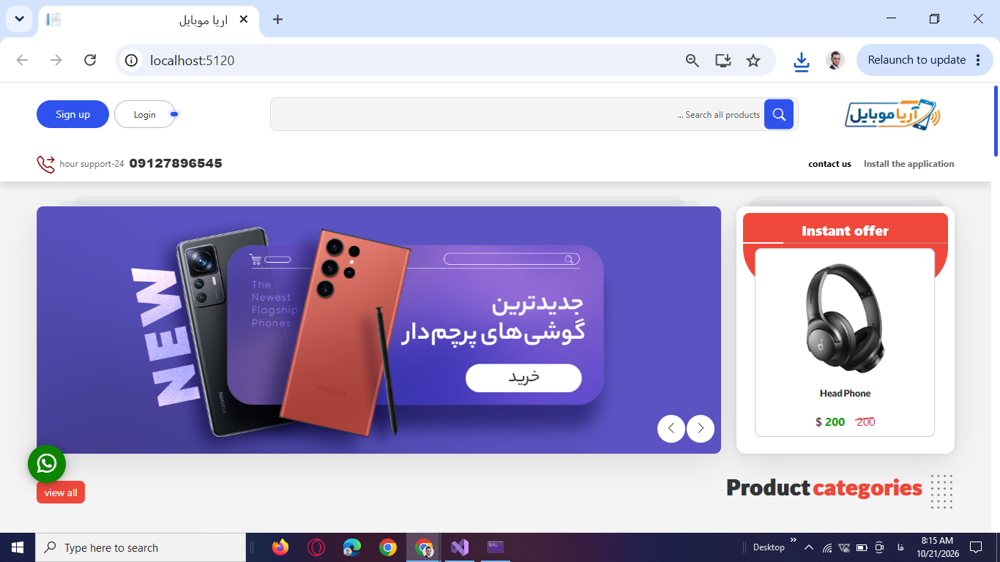
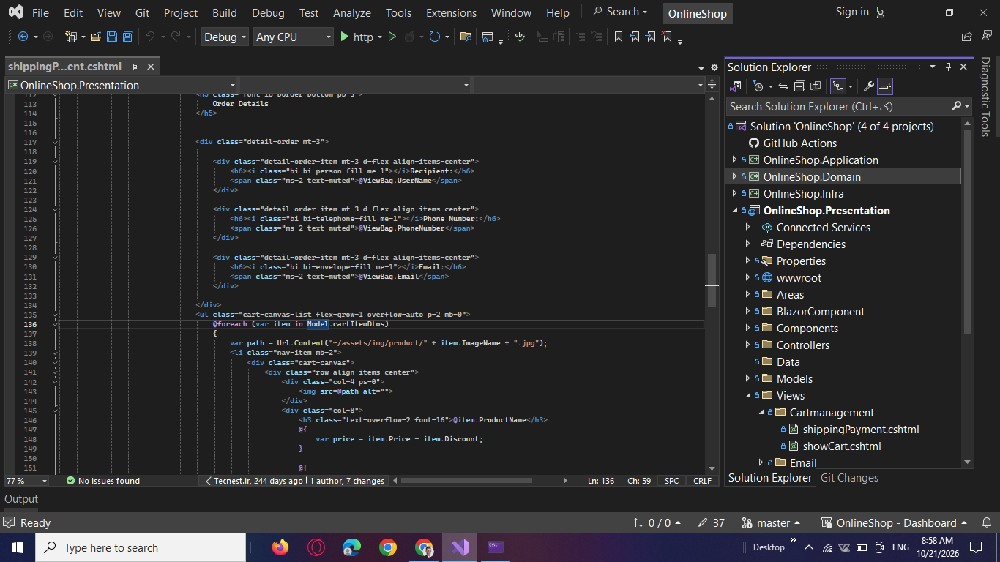
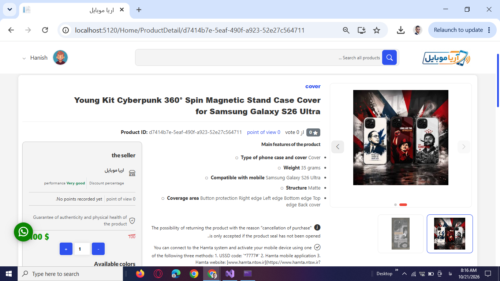
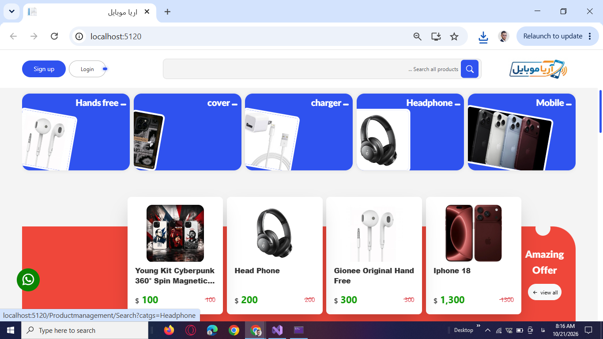
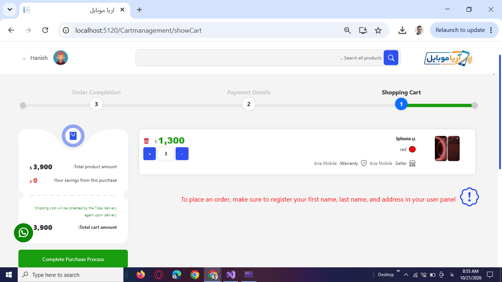
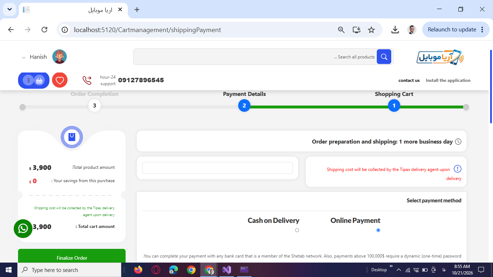
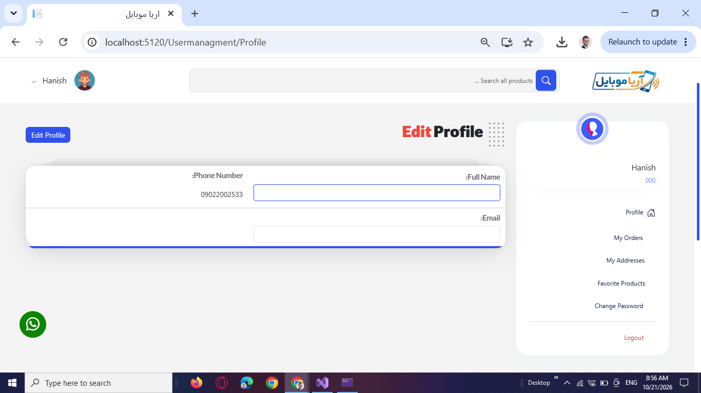
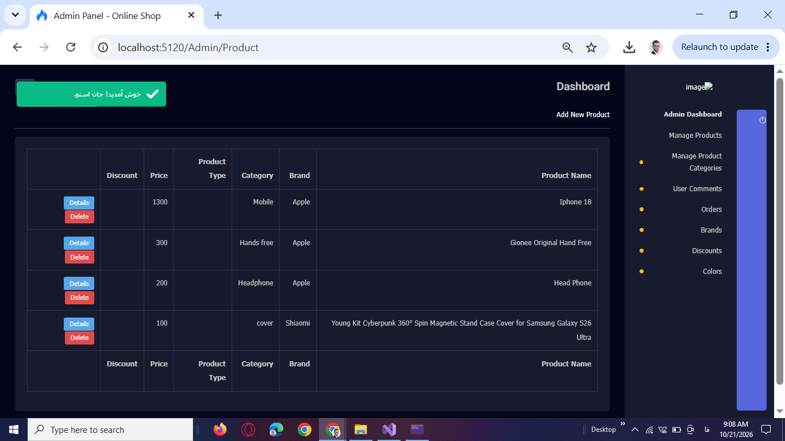

# OnlineShop — E-Commerce Web Application

An e-commerce web application developed with **C#, ASP.NET Core MVC, Entity Framework Core, and SQL Server** to support product browsing, shopping cart management, order processing, online payments, customer accounts, and product reviews.

The application brings essential online shopping workflows together in one system, helping customers discover products, manage their purchases, and track orders while providing administrators with tools to manage the product catalog, discounts, orders, and customer feedback.

**Project Focus:** Backend Development · E-Commerce Workflows · Entity Framework Core · Business Logic · Data Access · Payment Integration

---

## Project Preview

The homepage presents the product catalog and featured products, providing customers with an entry point to browse products and explore available offers.

## Project Overview

### The Problem

Online stores need reliable ways to organize product information, help customers find relevant items, manage shopping carts, process orders, and support online payments. Without connected workflows, maintaining product information and managing the customer shopping experience becomes more difficult.

### The Solution

OnlineShop provides a centralized e-commerce application with product browsing, search and filtering, shopping cart management, order workflows, Stripe Checkout integration, customer account features, and administrative tools for managing catalog data and customer reviews.

## Target Users

- **Online Shoppers:** Browse products, search the catalog, manage favorites and shopping carts, place orders, and manage customer accounts.
- **Store Administrators:** Manage products, categories, brands, product colors, discounts, and customer reviews.
- **Order Management Staff:** Review customer orders and access order details and payment status.

## Key Features

- **Product Catalog:** Browse products, categories, and brands, and view product images, attributes, colors, and related products.
- **Product Search & Filtering:** Search by keyword, filter by category and price range, sort results, and navigate paginated listings.
- **Shopping Cart:** Add and remove products and update item quantities before checkout.
- **Order Management:** Create orders from cart items and review order history, order details, and payment status.
- **Online Payments:** Integrate Stripe Checkout into the online payment workflow.
- **Customer Accounts:** Register, sign in, update profile information, change passwords, and manage delivery addresses.
- **Favorites:** Save products and manage a personal favorites list.
- **Product Reviews & Ratings:** Submit ratings, comments, strengths, and weaknesses for products.
- **Discount Management:** Create discounts and associate them with products.
- **Product & Catalog Administration:** Manage products, product images, categories, brands, and product colors.
- **Review Moderation:** Search customer comments and approve or unapprove reviews.
- **Access Control:** Restrict administrative operations using ASP.NET Core authorization, roles, and policies.

## Technical Stack

| Technology | Purpose |
|---|---|
| C# | Backend logic and application operations |
| ASP.NET Core MVC | Web application framework and request handling |
| Entity Framework Core | Data access, entity relationships, and database mappings |
| SQL Server | Relational data storage |
| ASP.NET Core Identity | User authentication and account management |
| Stripe Checkout | Online payment integration |
| DTOs | Data transfer between application components |
| LINQ | Data querying and filtering |
| Fluent API | Entity relationship and database configuration |
| Razor Views | Server-rendered user interface |
| HTML, CSS, JavaScript | Frontend presentation and interactions |

## Architecture & Design

The application follows Clean Architecture, organizing its code into four main layers: Domain, Application, Infrastructure, and Presentation.

Key implementation details include:

- **Separation of Responsibilities:** Organizes different parts of the application around their respective responsibilities.
- **Entity Framework Core:** Configures entity mappings and relationships through the database context and Fluent API.
- **ASP.NET Core Identity:** Provides user authentication and account management.
- **Soft Deletion:** Uses removal flags and timestamps for selected entities.
- **Global Query Filters:** Applies filtering rules to selected entities.
- **Audit Timestamps:** Handles entity creation and update timestamps.
- **Database Indexes:** Defines indexes on selected product, category, and brand fields.
- **Relational Data Modeling:** Connects products, categories, brands, carts, orders, payments, discounts, and customer reviews.

### Database Entities

The database context includes entities for:

- Products, product images, attributes, and colors
- Categories and brands
- Users and delivery addresses
- Shopping carts and cart items
- Orders and order items
- Payments
- Discounts and product discounts
- Favorites and product comments

## Selected Application Screenshots

The following screenshots highlight selected areas of the application. Each example focuses on a practical e-commerce problem and the functionality provided to address it.

### 1. Product Catalog & Homepage

**Problem:** Customers need an accessible way to discover products and explore available categories and offers.

**Solution:** The homepage presents product listings and selected product sections, helping customers browse the catalog and navigate to product details.

**Business Value:** Makes product discovery easier and provides a central starting point for the shopping journey.

### 2. Product Details

**Problem:** Customers need sufficient product information to compare options and make purchasing decisions.

**Solution:** Product detail pages present product information, images, attributes, colors, ratings, customer comments, and related products where available.

**Business Value:** Gives customers more context before adding products to their shopping carts.

### 3. Product Search & Catalog Browsing

**Problem:** Finding a specific product becomes more difficult as the catalog grows.

**Solution:** Product listings support keyword search, category and price filtering, sorting, and pagination.

**Business Value:** Helps customers narrow down product options and navigate the catalog more efficiently.

### 4. Shopping Cart Management

**Problem:** Customers need to review selected products and adjust quantities before proceeding to checkout.

**Solution:** The shopping cart supports adding and removing items and updating product quantities.

**Business Value:** Provides a clear place to review and manage intended purchases before order creation.

### 5. Checkout & Online Payments

**Problem:** Online stores need a payment workflow that connects customer orders with the checkout process.

**Solution:** The application creates orders from cart items and integrates Stripe Checkout into the online payment workflow.

**Business Value:** Connects order placement with an online payment experience.

### 6. Customer Account Management

**Problem:** Customers need to maintain their account information and delivery details when using the store.

**Solution:** Account features support profile updates, password changes, address management, favorites, and order access.

**Business Value:** Keeps customer information and shopping-related activities accessible through account features.

### 7. Product Administration

**Problem:** Store administrators need to maintain product information and keep the catalog organized.

**Solution:** The administration area supports product creation, editing, removal, image management, and access to related catalog-management functions.

**Business Value:** Provides a centralized interface for maintaining the store's product catalog.

## My Role & Contributions

I developed the application's backend and core e-commerce functionality, working on:

- Product catalog and product detail workflows.
- Product search, filtering, sorting, and pagination.
- Shopping cart and order creation workflows.
- Customer registration, authentication, and account management.
- Favorites, product reviews, ratings, and discount functionality.
- Administrative workflows for products, categories, brands, orders, and reviews.
- Entity Framework Core mappings, relationships, query filters, indexes, and timestamp handling.
- Stripe Checkout integration into the online payment workflow.

## Deployment

The project is an ASP.NET Core MVC web application backed by SQL Server. Its deployment configuration and production hosting status should be documented separately according to the environment in which this specific application has actually been deployed.

## Commercial Potential & Extensibility

OnlineShop provides a foundation for an e-commerce solution that can be adapted to different product catalogs and store requirements.

Potential future improvements include:

- Expanding payment lifecycle handling and webhook-based payment verification.
- Adding automated unit and integration tests.
- Improving structured logging and error handling.
- Enhancing database query performance as the catalog grows.
- Adding a REST API for applications that require API-based access.
- Extending the application with additional store configuration and business-specific features.

These are potential areas for further development rather than claims about functionality already implemented.

## Repository Notes

This repository serves as a showcase of the OnlineShop project, highlighting its purpose, technical stack, key features, architecture, and selected application screenshots.

The screenshots demonstrate representative customer-facing and administrative workflows without requiring visitors to browse the complete application source code.

**The source code is not included in this public showcase.**

Only sanitized demonstration screenshots should be published. Customer information, real order details, credentials, connection strings, API keys, and other sensitive information should not be exposed.

## Contact

- **GitHub:** [saeedrezasedaghat76-cloud](https://github.com/saeedrezasedaghat76-cloud)
- **LinkedIn:** [Saeed Sedaghat](https://www.linkedin.com/in/saeed-sedaghat/)
- **Email:** [sedaghatsaeedreza@yahoo.com](mailto:sedaghatsaeedreza@yahoo.com)
